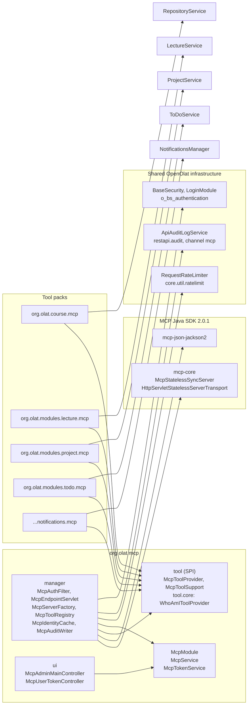
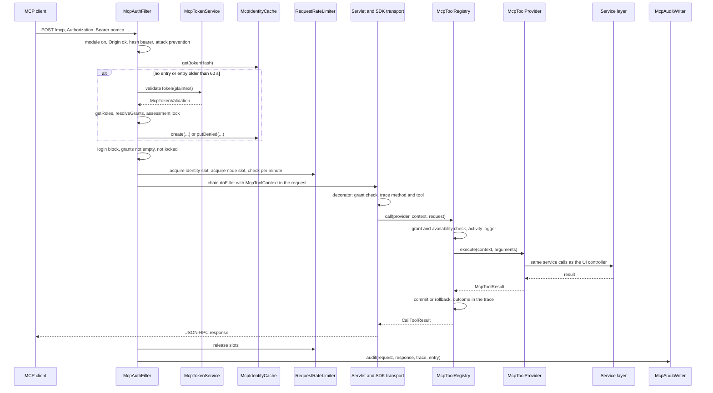
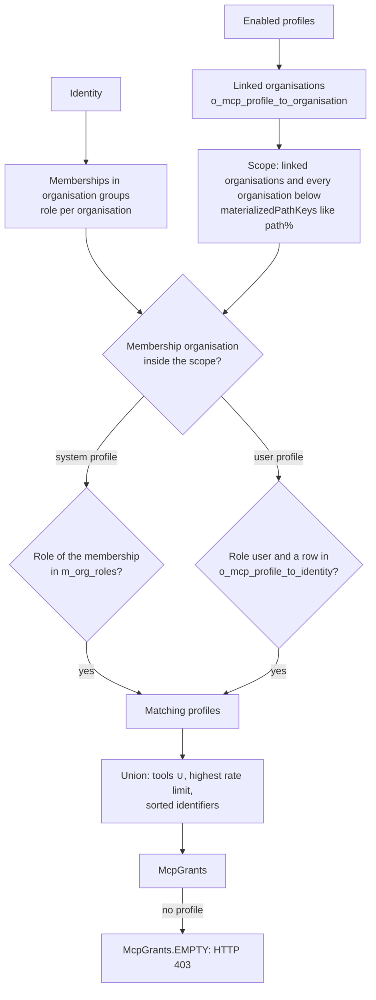
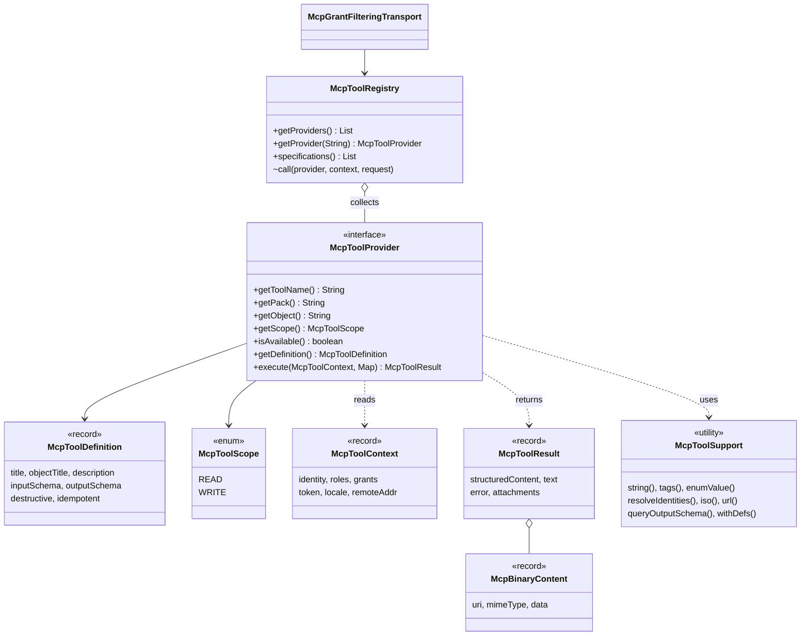
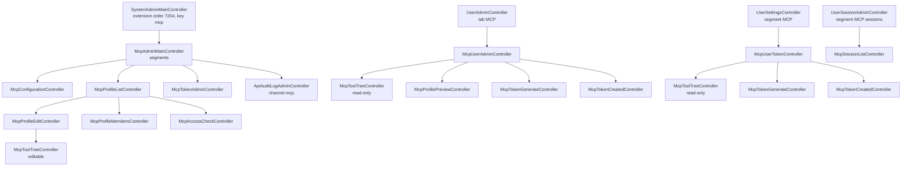
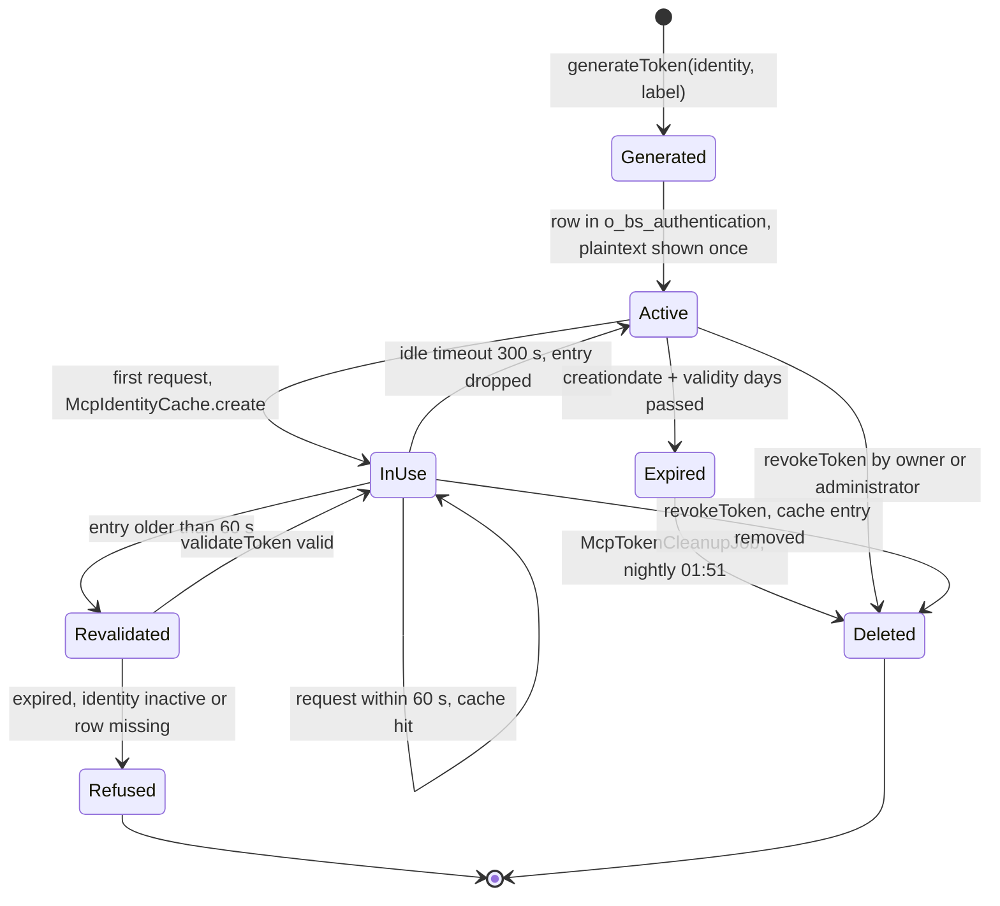

# MCP Server (`mcp`) Package Documentation

> **Package:** `org.olat.mcp`
> **Source root:** `src/main/java/org/olat/mcp/`
> **Purpose:** Provides the Model Context Protocol (MCP) server of OpenOlat. AI assistants such as Claude Code, VS Code or langchain4j agents connect to the endpoint `/mcp` with a personal MCP token. They call tools that read and change OpenOlat data for the token owner. Administrators decide with MCP profiles which tools a group of users gets. Every tool checks the object permissions again with the security callbacks of its module.

---

## Table of Contents

1. [Overview and Purpose](#1-overview-and-purpose)
2. [Core Domain Model](#2-core-domain-model)
3. [JPA Persistence Model](#3-jpa-persistence-model)
4. [Configuration](#4-configuration)
5. [Authentication and Request Pipeline](#5-authentication-and-request-pipeline)
6. [Profiles and Grant Resolution](#6-profiles-and-grant-resolution)
7. [Tool API (SPI and Registry)](#7-tool-api-spi-and-registry)
8. [Tool Packs and Tool Reference](#8-tool-packs-and-tool-reference)
9. [Adding a New Tool (Step-by-Step)](#9-adding-a-new-tool-step-by-step)
10. [UI Architecture](#10-ui-architecture)
11. [Sessions and Counting](#11-sessions-and-counting)
12. [Security Summary](#12-security-summary)
13. [Token Lifecycle and Cleanup Job](#13-token-lifecycle-and-cleanup-job)
14. [Compatibility and Versioning](#14-compatibility-and-versioning)
15. [Glossary](#15-glossary)

---

## 1. Overview and Purpose

The `mcp` package implements a **stateless MCP server inside the OpenOlat webapp**. It uses the official MCP Java SDK 2.0.1. A client sends JSON-RPC requests with `POST /mcp` and the header `Authorization: Bearer oomcp_...`. The servlet filter `McpAuthFilter` authenticates the token, resolves the grants of the token owner and applies the rate limits. The SDK transport then hands the request to the one `McpStatelessSyncServer` of the node. The server runs the tool on the servlet request thread. The tool calls the same services as the UI controllers.

### Key design principles

- **Tools on the service layer:** A tool calls the service methods that the UI controllers call, in the same order. Activity log, notifications, news and mails fire as in the UI. The tools do not use the REST API.
- **Two authorization layers:** The profile grants decide which tools exist for an account. The security callbacks of the module decide inside each tool which objects the account may read or change. A profile never widens the rights of a user.
- **Stateless on the wire and on the server:** The transport is POST only and JSON only. An MCP request never creates, reads or changes an HTTP session. The identity behind a token lives in a local Infinispan cache, keyed by the SHA-256 hash of the token.
- **Shared infrastructure:** The module reuses the `RequestRateLimiter` of `org.olat.core.util.ratelimit` and the audit log of `org.olat.restapi.audit` (table `o_api_audit_log`, channel `mcp`). The MCP settings are independent of the REST API settings.
- **Tokens in the authentication table:** An MCP token is a row of `o_bs_authentication` with the provider `MCP`. The row holds the hash, never the plaintext.
- **Packs in their modules:** The tools of a module live in the package `<module>.mcp` of that module, as the REST resources live in `<module>.restapi`. The MCP module holds the core, the SPI and `openolat_whoami`. It depends on no tool module.

### Package structure

```
mcp/
  *.java                    # Module, service interfaces, model interfaces and records (11 files)
  _spring/                  # mcpContext.xml: component scan and admin menu extension (1 file)
  manager/                  # Filter, servlet, server factory, registry, cache, services, DAO (16 files)
  model/                    # JPA entities of the profiles and their relations (3 files)
  tool/                     # Tool SPI and the helpers for every tool (9 files)
  tool/core/                # The tool openolat_whoami of the pack core (1 file)
  ui/                       # Administration, user administration tab, personal settings (27 files)
```

Templates (`*.html` Velocity files) live in `ui/_content/`. i18n files (`LocalStrings_XX.properties`) live in `ui/_i18n/`.

### Tool pack packages

| Pack | Package | Pack constant | Tools |
|------|---------|---------------|-------|
| `core` | `org.olat.mcp.tool.core` | `McpToolProvider.PACK_CORE` | 1 |
| `course` | `org.olat.course.mcp` | `CourseMcpPack.NAME` | 1 |
| `lecture` | `org.olat.modules.lecture.mcp` | `LectureMcpPack.NAME` | 1 |
| `notification` | `org.olat.core.commons.services.notifications.mcp` | `NotificationMcpPack.NAME` | 1 |
| `project` | `org.olat.modules.project.mcp` | `ProjectMcpPack.NAME` | 13 |
| `todo` | `org.olat.modules.todo.mcp` | `ToDoMcpPack.NAME` | 2 |

### Package and dependency diagram

The arrows point from the user of a class to the class. The packs depend on the SPI in `org.olat.mcp.tool`. The MCP core does not know the packs. Spring collects the providers at startup.



*Figure 1: Package and dependency diagram: core module, SPI, the packs in their modules and the reused rate limiter and audit log*

---

## 2. Core Domain Model

### Overview

```
McpProfile (o_mcp_profile)                  # admin-defined toolset
  |-- type: system | user
  |-- tools: Set<String>                    # tool names, JSON in m_tools
  |-- organisationRoles                     # system profile only
  |-- rateLimitRequestsPerMinute            # optional override
  |-- organisations  -> o_mcp_profile_to_organisation   (at least one)
  |-- grants         -> o_mcp_profile_to_identity       (user profile)

McpToken (row of o_bs_authentication, provider MCP)
  |-- tokenId (authusername), label (externalid), owner (identity_fk)
  |-- credential: SHA-256 hex of the plaintext

McpGrants (record, computed)                # union of the matching enabled profiles
McpIdentityEntry (record, cached)           # per token hash: session, roles, grants, token
```

### McpProfile

An `McpProfile` is a toolset that an administrator defines. It answers two questions: which tools, and for whom.

```java
// File: McpProfile.java
public interface McpProfile extends McpProfileRef, CreateInfo, ModifiedInfo {
    String IDENTIFIER_PATTERN = "^[a-z0-9][a-z0-9-]{2,63}$";  // lowercase letters, digits, hyphens

    String getIdentifier();                      // unique admin slug, never part of an URL
    String getName();
    String getDescription();
    boolean isEnabled();
    McpProfileType getType();                    // system or user
    Set<String> getTools();                      // names of the granted tools, never null
    List<OrganisationRoles> getOrganisationRoles();   // system profile only, empty for a user profile
    Integer getRateLimitRequestsPerMinute();     // override, null for the module default
}
```

The identifier has 3 to 64 characters. The identifier and the type cannot change after the creation. `McpProfileRef` carries the key only.

### McpProfileType

```java
public enum McpProfileType {
    system,   // applies to every identity with one of the organisation roles of the profile
    user;     // applies to the identities with an explicit grant
}
```

| Type | Who matches | Roles | Grants |
|------|-------------|-------|--------|
| `system` | An identity with one of the roles of the profile in an organisation of the scope | Selected by the administrator, without `guest` and `invitee` | Ignored |
| `user` | An identity with an explicit grant and the role `user` in an organisation of the scope | Always empty: `updateProfile` clears them | Rows in `o_mcp_profile_to_identity` |

### Organisation scope

Every profile is linked to at least one organisation (`o_mcp_profile_to_organisation`). A profile applies to its organisations and to every organisation below them. The query compares the materialized path of the organisation of the membership with the path of the linked organisation (`like concat(path, '%')`). Deleted organisations do not count. `McpService.updateProfile` refuses to enable a profile without organisation.

### McpGrants

`McpGrants` is the immutable result of the grant resolution for one identity. The identity cache holds it.

```java
// File: McpGrants.java
public record McpGrants(Set<String> tools, Integer requestsPerMinute, List<String> profileIdentifiers) {
    public static final McpGrants EMPTY = new McpGrants(Set.of(), null, List.of());

    public boolean isEmpty();                  // no matching profile: no MCP access
    public boolean isGranted(String toolName); // one of the matching profiles grants the tool
}
```

- `tools`: the union of the tools of every matching enabled profile.
- `requestsPerMinute`: the highest override of the matching profiles, `null` for the module default.
- `profileIdentifiers`: the sorted identifiers of the matching profiles, for `openolat_whoami` and the audit row.

`McpGrants` holds the full union. The availability of a pack (module switch) is not part of the grants. The transport decorator and the registry check it on every request.

### McpToken

An MCP token is a row of `o_bs_authentication`. The record `McpToken` holds the metadata, never the plaintext and never the hash.

```java
// File: McpToken.java
public record McpToken(Long key, String tokenId, String label, Identity identity,
        Date creationDate, Date expirationDate) {
    public boolean isExpired(Date now);   // expirationDate != null && expirationDate.before(now)
}
```

| Column of `o_bs_authentication` | MCP value |
|---------------------------------|-----------|
| `provider` | `MCP` (`McpTokenService.MCP_AUTH_PROVIDER`) |
| `issuer` | `DEFAULT` (`BaseSecurity.DEFAULT_ISSUER`) |
| `authusername` | The token id `t_` plus 14 base62 characters (80 random bits) |
| `externalid` | `<identityKey>:<label>`, the label has at most 200 characters |
| `credential` | SHA-256 hex of the plaintext, no salt, one iteration |
| `hashalgorithm` | `sha256` |
| `creationdate` | Start of the validity |
| `identity_fk` | The owner |

The plaintext is `oomcp_` plus 33 base62 characters (192 random bits from `SecureRandom`). The expiration date is not stored. `McpTokenServiceImpl` computes it from `creationdate` plus `mcp.token.validity.days`. Two records carry the token through the service API:

- `McpTokenCreation(String plaintext, McpToken token)`: the result of a generation. Its `toString()` leaves the plaintext out.
- `McpTokenValidation(Status status, McpToken token, String tokenHash)`: the result of a validation. The status is `valid`, `unknown`, `expired` or `identityInactive`.

The column `hashalgorithm` holds `sha256`. This value is not the salted, iterated `Encoder.Algorithm.sha256`. `BaseSecurity.checkCredentials` therefore always fails for an MCP row. Only `McpTokenService` validates MCP tokens.

### McpIdentityEntry and McpSessionActivity

The filter caches one `McpIdentityEntry` per token hash. The entry saves the identity, roles and grants queries between two requests. The bearer is still verified on every request.

```java
// File: manager/McpIdentityEntry.java
public record McpIdentityEntry(UserSession userSession, Roles roles, McpGrants grants, McpToken token,
        long createdAt, boolean assessmentLocked, McpSessionActivity activity) {
    public Identity getIdentity();   // identity of the session, or the token owner without session
    public Long getIdentityKey();
}
```

| Field | Meaning |
|-------|---------|
| `userSession` | Detached non-GUI `UserSession`, never signed on. `null` for an entry without grants (denied entry). |
| `roles` | The roles of the identity at creation time (`BaseSecurity.getRoles`). |
| `grants` | The resolved grants at creation time. |
| `token` | The token metadata, for the audit row and the expiry check. |
| `createdAt` | Creation time in milliseconds. The filter re-validates the entry after 60 seconds. |
| `assessmentLocked` | `true` if an assessment mode or an assessment inspection locks the identity. |
| `activity` | `McpSessionActivity`: client IP, user agent (at most 120 characters), first request, last request, time of the last login write. |

`McpSessionActivity.touch(long)` writes the last request time in place, with one volatile field write. The cache holds the object by reference, so a request never puts the entry again.

### McpProfileChangedEvent

`McpService` fires a `McpProfileChangedEvent` (a `MultiUserEvent`) on the event bus after every change of a profile, of an organisation link or of a grant. The resource is `McpProfileChangedEvent.ORES` (type `McpProfile`). `McpIdentityCache` listens on every node and drops all its entries. The service commits before it fires the event, so a node that reloads the grants sees the committed state.

---

## 3. JPA Persistence Model

### Table: `o_mcp_profile`

**McpProfileImpl** (`model/McpProfileImpl.java`):

```java
@Entity(name="mcpprofile")
@Table(name="o_mcp_profile")
public class McpProfileImpl implements McpProfile, Persistable {
    @Id @GeneratedValue(strategy = GenerationType.IDENTITY)
    @Column(name="id")                   private Long key;
    @Column(name="creationdate")         private Date creationDate;
    @Column(name="lastmodified")         private Date lastModified;
    @Column(name="m_identifier", updatable=false) private String identifier;  // max. 64
    @Column(name="m_name")               private String name;                 // max. 255
    @Column(name="m_description")        private String description;
    @Column(name="m_enabled")            private boolean enabled;
    @Enumerated(EnumType.STRING)
    @Column(name="m_type", updatable=false) private McpProfileType type;
    @Column(name="m_tools")              private String toolsJson;            // JSON array of tool names
    @Column(name="m_org_roles")          private String organisationRolesString; // comma-separated
    @Column(name="m_ratelimit_rpm")      private Integer rateLimitRequestsPerMinute;
}
```

- `setTools(Set<String>)` trims the names, drops blank names, sorts them and writes the JSON array. `getTools()` parses the column once and keeps the result in a transient field.
- `getOrganisationRoles()` ignores unknown role names. The list follows the order of the enumeration `OrganisationRoles`.
- The DAO query compares the roles as `,role,` inside `concat(',', m_org_roles, ',')`.

### Table: `o_mcp_profile_to_identity`

**McpProfileToIdentityImpl** (`model/McpProfileToIdentityImpl.java`), entity name `mcpprofiletoidentity`. One row per explicit grant of a user profile: `id`, `creationdate`, `fk_profile`, `fk_identity`.

### Table: `o_mcp_profile_to_organisation`

**McpProfileToOrganisationImpl** (`model/McpProfileToOrganisationImpl.java`), entity name `mcpprofiletoorganisation`. One row per organisation of a profile: `id`, `creationdate`, `fk_profile`, `fk_organisation`.

### DDL (PostgreSQL)

From `src/main/resources/database/postgresql/alter_21_1_x_to_21_2_0.sql`. The MySQL and Oracle files and the three `setupDatabase.sql` files hold the same tables.

```sql
create table o_mcp_profile (
   id bigserial,
   creationdate timestamp not null,
   lastmodified timestamp not null,
   m_identifier varchar(64) not null,
   m_name varchar(255) not null,
   m_description text,
   m_enabled bool default false not null,
   m_type varchar(16) not null,
   m_tools text,
   m_org_roles varchar(1024),
   m_ratelimit_rpm int4,
   primary key (id)
);

create table o_mcp_profile_to_identity (
   id bigserial,
   creationdate timestamp not null,
   fk_profile int8 not null,
   fk_identity int8 not null,
   primary key (id)
);

create table o_mcp_profile_to_organisation (
   id bigserial,
   creationdate timestamp not null,
   fk_profile int8 not null,
   fk_organisation int8 not null,
   primary key (id)
);
```

### Indexes and constraints

| Name | Table | Columns | Kind |
|------|-------|---------|------|
| `idx_mcp_profile_ident_idx` | `o_mcp_profile` | `m_identifier` | unique index |
| `mcp_prof_to_id_prof_idx` | `o_mcp_profile_to_identity` | `fk_profile` | foreign key to `o_mcp_profile` |
| `mcp_prof_to_id_ident_idx` | `o_mcp_profile_to_identity` | `fk_identity` | foreign key to `o_bs_identity` |
| `idx_mcp_prof_to_id_uniq_idx` | `o_mcp_profile_to_identity` | `fk_profile, fk_identity` | unique index |
| `mcp_prof_to_org_prof_idx` | `o_mcp_profile_to_organisation` | `fk_profile` | foreign key to `o_mcp_profile` |
| `mcp_prof_to_org_org_idx` | `o_mcp_profile_to_organisation` | `fk_organisation` | foreign key to `o_org_organisation` |
| `idx_mcp_prof_to_org_uniq_idx` | `o_mcp_profile_to_organisation` | `fk_profile, fk_organisation` | unique index |

Every foreign key has a plain index with the prefix `idx_` as well.

### Important JPA notes

- The three entities are registered in `src/main/resources/META-INF/persistence.xml`.
- The tokens need no table of their own. The lookup by hash uses the existing index on `o_bs_authentication.credential` through `BaseSecurity.findAuthenticationByToken("MCP", hash)`.
- `McpProfileDAO` holds every query on the three tables. The lists of grants are paginated, because the number of grants can be large.
- `McpProfileDAO.deleteProfile` deletes the grants and the organisation links first, then the profile.

---

## 4. Configuration

### Properties and defaults

`McpModule` (`@Service("mcpModule")`, extends `AbstractSpringModule`) reads these properties from `olat.properties`. The administration persists a changed value as a module property, which wins over `olat.properties` and is shared in the cluster.

| Property | Default | Meaning |
|----------|---------|---------|
| `mcp.enabled` | `false` | Switches the endpoint `/mcp` on. Independent of `restapi.enable`. When off, the filter answers 404. |
| `mcp.user.token.generation.enabled` | `true` | Users may generate tokens in their personal settings. When off, only a manager in the user administration issues tokens. |
| `mcp.user.token.max` | `5` | Maximum number of tokens per user, `0` for no limit. |
| `mcp.token.validity.days` | `365` | Validity of a token in days after its creation, `0` for no expiry. |
| `mcp.session.timeout` | `300` | Idle timeout in seconds of an identity cache entry. |
| `mcp.session.cache.size` | `20000` | Maximum number of identity cache entries per node. Read when the cache starts. Above it the least recently used entry is dropped. |
| `mcp.ratelimit.enabled` | `true` | Switches the rate limits of the endpoint on. |
| `mcp.ratelimit.requests.per.minute` | `120` | Requests per minute of a token owner, fixed window of 60 seconds. A profile can set a higher value. |
| `mcp.ratelimit.max.parallel` | `2` | Parallel requests of a token owner. |
| `mcp.ratelimit.max.parallel.node` | `32` | Parallel MCP requests of the whole node, `0` disables the cap. Protects the request threads and the database connections of the web interface. |
| `mcp.ratelimit.anonymous.requests.per.minute` | `30` | Requests per minute of a client IP without grants: without a valid token, or with a valid token without enabled profile. |
| `mcp.auditlog.enabled` | `true` | Writes audit rows of the channel `mcp`. |
| `mcp.auditlog.reads` | `false` | Also writes rows for `tools/list`, `initialize` and successful read tool calls. High volume. |
| `mcp.auditlog.body` | `true` | Stores the tool arguments as masked JSON. |
| `mcp.auditlog.body.maxsize` | `16384` | Maximum stored size of the arguments in bytes. |
| `mcp.request.maxsize` | `10485760` | Maximum size of a request body in bytes (10 MiB), read at startup. It bounds the file content that `file_modify create` can upload. |

The module also keeps the persisted flag `mcp.default.profiles.created`. It is not in `olat.properties`. `McpServiceImpl` sets it after the seeding of the default profiles (see [section 6](#6-profiles-and-grant-resolution)).

`mcp.session.cache.size` and `mcp.request.maxsize` have no form element in the administration. They take effect at the next start.

### Module interfaces

`McpModule` implements `ConfigOnOff` and `ApiAuditChannelSettings`. The second interface gives the shared audit log service the settings of the channel `mcp`:

```java
public class McpModule extends AbstractSpringModule implements ConfigOnOff, ApiAuditChannelSettings {
    public static final String MCP_ENDPOINT = "/mcp";

    public ApiAuditChannel getAuditChannel()  { return ApiAuditChannel.mcp; }
    public boolean isAuditLogEnabled();
    public boolean isAuditLogReads();
    public boolean isAuditLogBody();
    public int getAuditLogBodyMaxSize();
}
```

The retention of the audit rows follows `restapi.auditlog.retention.days`. One retention job covers both channels.

### Spring and web.xml

| File | Content |
|------|---------|
| `org/olat/mcp/_spring/mcpContext.xml` | Component scan of `org.olat.mcp`. A `GenericActionExtension` with order `7204`, navigation key `mcp` and parent `sysconfigParent` puts `McpAdminMainController` into the system administration, directly below the REST API (`7203`). |
| `org/olat/_spring/mainContext.xml` | Imports `mcpContext.xml`. |
| `schedulerContext.xml` | The trigger `mcpTokenCleanupTrigger` runs `McpTokenCleanupJob` every day at 01:51 (`0 51 1 * * ?`), only on the cluster singleton node. |
| `web.xml` (tomcat, wildfly, jbosseap) | Filter `McpAuthFilter` and servlet `mcpservlet` (`McpEndpointServlet`), both mapped to the exact path `/mcp`. |

```xml
<filter>
    <filter-name>McpAuthFilter</filter-name>
    <filter-class>org.olat.mcp.manager.McpAuthFilter</filter-class>
</filter>
<servlet>
    <servlet-name>mcpservlet</servlet-name>
    <servlet-class>org.olat.mcp.manager.McpEndpointServlet</servlet-class>
    <async-supported>true</async-supported>
    <load-on-startup>3</load-on-startup>
</servlet>
<servlet-mapping>
    <servlet-name>mcpservlet</servlet-name>
    <url-pattern>/mcp</url-pattern>
</servlet-mapping>
<filter-mapping>
    <filter-name>McpAuthFilter</filter-name>
    <url-pattern>/mcp</url-pattern>
</filter-mapping>
```

`async-supported` stays for a later transport change. The stateless transport does not use it.

### Maven

`pom.xml` sets `mcp.sdk.version` to `2.0.1` and adds `io.modelcontextprotocol.sdk:mcp-core` and `io.modelcontextprotocol.sdk:mcp-json-jackson2`. The exclusions keep the Jackson 2 version of OpenOlat.

---

## 5. Authentication and Request Pipeline

### Components

| Class | Role |
|-------|------|
| `McpAuthFilter` | Servlet filter on `/mcp`. Module switch, Origin check, bearer token, attack prevention, identity cache, login block, assessment lock, rate limits, request attributes, audit. Not a Spring bean: it looks up its collaborators through `CoreSpringFactory`. |
| `McpEndpointServlet` | Delegates `service(request, response)` to `McpServerFactory.service(...)`. |
| `McpServerFactory` | Spring bean. Builds the transport, the decorator and the server once at startup. |
| `McpGrantFilteringTransport` | Decorator of the SDK transport. Filters `tools/list`, refuses ungranted calls, records the JSON-RPC method in the trace. |
| `McpToolRegistry` | Collects the providers, builds the tool specifications and wraps every call. |
| `McpTokenService` | Generation, validation, revocation and cleanup of tokens. |
| `McpIdentityCache` | Spring bean. The local Infinispan caches `McpManager-identity` and `McpManager-denied`. |
| `McpAuditWriter` | Builds the audit row from the trace and writes it after the response. |
| `McpRequestTrace` | Collects the JSON-RPC method, the tool, the arguments, the outcome and the error reference of one request. |

### Request sequence



*Figure 2: Request sequence from the client through the filter, the token service, the identity cache, the rate limiter, the registry and the tool to the audit writer*

### McpAuthFilter step by step

The filter runs these steps in this order. The first step that refuses the request writes the answer and ends the request.

1. **Module switch.** `McpModule.isEnabled()` is `false`: HTTP 404, nothing else happens.
2. **Counters and trace.** `SessionStatsManager.incrementRequest()` and `incrementConcurrentCounter()` count the request, because `OpenOLATServlet` never sees it. The filter puts the start time and a new `McpRequestTrace` into the request attributes.
3. **Origin check.** A request with an `Origin` header must come from the scheme, host and port of `Settings.getServerContextPathURI()`. The value `null` is refused. A request without `Origin` passes (Claude Code sends none). Mismatch: HTTP 403 "Origin not allowed". The MCP specification requires this check against DNS rebinding.
4. **Bearer.** `bearerOf(request)` reads `Authorization: Bearer <value>`. A present value is hashed with SHA-256 (`McpTokenService.hash`).
5. **Attack prevention.** `LoginModule.isLoginBlocked` checks the key `mcp:tok:<hash>` with the login limit and the key `mcp:ip:<address>` with 10 times the login limit (`IP_ATTEMPTS_FACTOR`). A blocked token or IP gets HTTP 429 with `Retry-After` of `login.AttackPreventionTimeoutmin` (default 5 minutes). No cache lookup and no database query happens. No audit row is written.
6. **Identity entry.** `resolveEntry(...)` returns the entry or `null`:
    - A value without the prefix `oomcp_` is refused at once.
    - A cache hit with an expired token removes the entry and refuses the request.
    - A cache hit younger than `REVALIDATE_AFTER_MS` (60 seconds) is used. `activity().touch(now)` writes the last request time.
    - A denied entry younger than 60 seconds is used. It holds a valid token without enabled profile.
    - Otherwise `McpTokenService.validateToken(plaintext)` checks the format, loads the row by hash, checks the expiry and calls `BaseSecurity.isIdentityLoginAllowed(identity, "MCP")`. An invalid result removes the old entry and refuses the request.
    - A valid token loads the roles (`BaseSecurity.getRoles`) and the grants (`McpService.resolveGrants(identity)`). Empty grants: the filter caches a denied entry without session (`putDenied`) for 60 seconds.
    - With grants, the filter clears the failed attempts of the token, computes the assessment lock and calls `McpIdentityCache.create(...)`. The new entry keeps the first request time of the old entry.
    - **Last login.** If `McpSessionActivity.isLastLoginDue(now, LAST_LOGIN_INTERVAL_MS)` is `true`, the filter calls `BaseSecurity.setIdentityLastLogin(identity)`. This also computes the planned inactivation and deletion dates again. The write happens at most once per 5 minutes and token. A request served from the cache never writes it.
7. **Unauthenticated request.** No entry: `rejectUnauthenticated(...)` first applies the IP limit (`mcp:ip:<address>`, `mcp.ratelimit.anonymous.requests.per.minute`). Then it counts the failed attempt for the token and for the IP. A token or IP that reaches the limit with this attempt gets HTTP 429. Every other case gets HTTP 401 with `WWW-Authenticate: Bearer realm="OpenOlat MCP"` and the uniform message "Unauthorized".
8. **Login block.** `AuthHelper.isLoginBlocked()` is `true` and the owner is neither administrator nor system administrator: HTTP 403 "Login is blocked by the administrator". The flag is read on every request.
9. **No grants.** The entry has empty grants: the IP limit applies first, then HTTP 403 "No MCP access configured for this account". A 401 would count as a failed attempt and tell the client to authenticate again, which does not help.
10. **Assessment lock.** The entry is locked: HTTP 403 "Assessment in progress, the account is locked". The lock follows the rule of `AuthHelper.doLogin`: an active assessment mode (lead time, assessment, follow-up, extra time) or an assessment inspection locks every user except administrators and system administrators. The lock is computed with the token validation, so it takes effect within 60 seconds.
11. **Rate limits.** When `mcp.ratelimit.enabled` is `true`:
    - `acquire("mcp:id:<identityKey>", max.parallel)`: a third parallel request of the owner gets HTTP 429 with `Retry-After: 1`.
    - `acquire("mcp:node", max.parallel.node)` when the cap is above 0: HTTP 429 with `Retry-After: 1`.
    - `check("mcp:id:<identityKey>", limit)` with the profile override or the module default. The answer carries `X-RateLimit-Limit`, `X-RateLimit-Remaining` and `X-RateLimit-Reset`. Above the limit: HTTP 429 with `Retry-After`.
12. **Request attributes.** The filter builds the `McpToolContext` (identity, roles, grants, token, locale of the user, client IP). It puts the context into `McpToolRegistry.CTX_TOOL_CONTEXT`, the detached user session into `CTX_USER_SESSION` and `MCP` into `ApiAuditLogService.REQ_ATTR_AUTH_PROVIDER`.
13. **Chain.** `chain.doFilter(...)` reaches `McpEndpointServlet`. The tool runs on this thread.
14. **Exception.** An exception outside the registry gets an error reference (a UUID), the outcome `serverError` and a log line with the reference. An uncommitted response gets HTTP 500 "Internal error".
15. **Finally.** The filter releases the two slots, removes the i18n info of the thread, calls `DBFactory.getInstance().commitAndCloseSession()`, writes the audit row, clears the request tracing and decrements the concurrent counter.

Every error answer of the filter is JSON: `{"code":<status>,"message":"<text>"}`.

### Rejections and the audit log

A 429 writes an audit row only for the first rejection per window and subject. `RateLimitDecision.firstRejection()` and `RequestRateLimiter.markParallelRejection(key)` decide it. Every other rejection sets `ApiAuditLogService.REQ_ATTR_DONE`, and `McpAuditWriter` skips the row. A flood of rejected requests therefore does not flood the audit table.

### Error answers of the filter

| Situation | Status | Message |
|-----------|--------|---------|
| Module disabled | 404 | (container error page) |
| Foreign or `null` Origin | 403 | Origin not allowed |
| Blocked token or IP | 429 | Too many requests, retry after N seconds |
| No bearer, malformed, unknown, expired or revoked token, inactive identity | 401 | Unauthorized |
| Administrative login block | 403 | Login is blocked by the administrator |
| Valid token, no enabled profile | 403 | No MCP access configured for this account |
| Assessment mode or inspection | 403 | Assessment in progress, the account is locked |
| Rate limit or parallel cap | 429 | Too many requests, retry after N seconds |
| Exception outside the registry | 500 | Internal error |
| GET or DELETE on `/mcp` | 405 | (SDK transport) |
| `Accept` header without `application/json` and `text/event-stream` | 400 | (SDK transport) |
| Body above `mcp.request.maxsize` | 413 | (SDK transport) |

### The identity cache

`McpIdentityCache` is a Spring `@Service` class. It defines its two local Infinispan caches in the code, not in `infinispan-config.xml`, because the size follows `mcp.session.cache.size`.

| Cache | Key | Value | Expiry | Size |
|-------|-----|-------|--------|------|
| `McpManager-identity` | token hash | `McpIdentityEntry` with session | Idle timeout `mcp.session.timeout` (300 s) | `mcp.session.cache.size`, least recently used entry dropped |
| `McpManager-denied` | token hash | `McpIdentityEntry` without session, empty grants | Lifespan and idle time 60 s | same |

```java
// File: manager/McpIdentityCache.java
@Service
public class McpIdentityCache implements GenericEventListener {
    public McpIdentityEntry get(String tokenHash);
    public McpIdentityEntry getDenied(String tokenHash);
    public void putDenied(String tokenHash, McpIdentityEntry entry);
    public McpIdentityEntry create(String tokenHash, HttpServletRequest request, Identity identity, Roles roles,
            McpGrants grants, McpToken token, boolean assessmentLocked, McpSessionActivity previousActivity);
    public void remove(String tokenHash);        // drops the entry and the denied entry
    public void clear();                         // drops every entry of this node, on McpProfileChangedEvent
    public int size();                           // MCP sessions of this node, denied entries excluded
    public List<McpIdentityEntry> entries();     // copy for the session administration
    public int countActive(int numOfSeconds);    // entries with a request inside the window
}
```

`create(...)` builds the **detached user session**:

- `new UserSession()`, the identity set on the identity environment directly. `UserSession.setIdentity()` is not called, because it registers the session on the global event bus and only a sign off removes it again.
- A `SessionInfo` with the client IP, the user agent, the secure flag and the auth provider `MCP`.
- `setAuthenticated(true)` and `reloadPreferences()`.
- No HTTP session, no `UserSessionManager.signOn`. The session never reaches the servlet container, so no response carries a session cookie that could open the GUI, the REST API or WebDAV.

`entries()` iterates the data container. An iteration does not count as an access for the idle expiration, so the session list of the administration does not keep an entry alive.

### Server assembly

`McpServerFactory.afterPropertiesSet()` builds the server once per node:

```java
transport = HttpServletStatelessServerTransport.builder()
        .jsonMapper(jsonMapper)
        .messageEndpoint(McpModule.MCP_ENDPOINT)
        .contextExtractor(McpServerFactory::extractContext)  // copies the three request attributes
        .maxRequestSize(maxRequestSize)
        .build();
server = McpServer.sync(new McpGrantFilteringTransport(transport, toolRegistry))
        .serverInfo("OpenOlat", Settings.getVersion())
        .instructions(INSTRUCTIONS)
        .capabilities(McpSchema.ServerCapabilities.builder().tools(Boolean.FALSE).build())
        .jsonMapper(jsonMapper)
        .jsonSchemaValidator(new McpJsonSchemaValidator(objectMapper))
        .immediateExecution(true)
        .tools(toolRegistry.specifications())
        .build();
```

- `extractContext(request)` copies `CTX_TOOL_CONTEXT`, `CTX_USER_SESSION` and `McpRequestTrace.KEY` from the request attributes into the `McpTransportContext` of the SDK.
- `immediateExecution(true)` runs the synchronous tool handler on the servlet request thread. The thread locals of the request (activity logger, database session, request tracing) are therefore the ones of the tool.
- `tools(Boolean.FALSE)` announces the tools capability without `listChanged`. The tool list is fixed per deployment.
- The `INSTRUCTIONS` tell the model to call `openolat_whoami` first.

### McpGrantFilteringTransport

The SDK 2.0.1 has no per-request tool filter. The decorator wraps the stateless transport and intercepts the handler that the server installs:

- **Every request:** records the JSON-RPC method in the trace.
- **`tools/call`:** `denyUngrantedCall(...)` records the tool name, the scope and the arguments in the trace. A tool outside the grants, an unknown tool or a tool of a disabled pack gets a tool result with `isError` and the text "Tool X is not available for this account. Call openolat_whoami to see the granted tools." The check runs before the SDK validates the arguments, so the error message never reveals the input schema of the tool. An unknown tool gets the same text as an ungranted tool.
- **`tools/list`:** `filterTools(...)` reduces the list to the granted and available tools. The order is the order of the registry: pack, then name.
- **Errors:** a JSON-RPC error or a tool result with `isError` from the SDK input validation sets the outcome `toolError`.

`McpJsonSchemaValidator` validates the arguments against the input schema (JSON Schema 2020-12) with English messages. The default validator of the SDK uses the locale of the JVM. Compiled schemas are cached per schema.

### Audit

`McpAuditWriter.audit(...)` builds an `ApiAuditEntry` with `ApiAuditChannel.mcp` and hands it to `ApiAuditLogService.logInNewTransaction(...)`. It never throws.

| Audit field | MCP value |
|-------------|-----------|
| status | HTTP status of a rejected request; for HTTP 200 the outcome of the trace: `success` 200, `toolError` 422, `denied` 403, `serverError` 500 |
| auth provider | `MCP`, or `ApiAuditLogService.AUTH_NONE` without entry |
| identity | The token owner |
| resource class | JSON-RPC method: `initialize`, `tools/list`, `tools/call`, `ping` |
| resource method | Tool name |
| path params | JSON with `action`, `profiles`, `token` (token id) and `errorReference` |
| read operation | `McpRequestTrace.isReadOperation()`: `true` for a request without tool and for a successful call of a READ tool |
| request body | Masked arguments (`ApiAuditMasking.maskNode`), only for a stored row and with `mcp.auditlog.body` |
| ref | The error reference of a server error |

`ApiAuditLogService.isAuditable(entry)` decides with `mcp.auditlog.reads` whether a read row is stored. Every write call and every 401, 403, 422, 429 and 5xx is stored. The trace keeps a bounded copy of the arguments: a string longer than 1024 characters (`MAX_ARGUMENT_LENGTH`) is cut, so a large upload is not held until the end of the request. The writer cuts the JSON to `mcp.auditlog.body.maxsize` bytes at a UTF-8 character boundary.

### Nothing leaks a secret

- The plaintext of a token exists only in the request header and in the dialog that shows it once. It is never stored and never logged.
- The cache key, the failed-attempt key and the stored credential are the hash.
- Logs and audit rows carry the token id (`t_...`), never the plaintext.
- The 401 message is uniform. The client cannot tell an unknown token from an expired token or an inactive account.
- An unknown tool and an ungranted tool get the same answer.
- Every project and ToDo tool answers an unknown key and a foreign key with the same permission error.

---

## 6. Profiles and Grant Resolution

### McpService

`McpService` (implementation `McpServiceImpl`) manages the profiles, the organisation links and the grants. It also resolves the grants of an identity.

```java
// File: McpService.java
public interface McpService {
    McpProfile createProfile(String identifier, String name, McpProfileType type,
            Collection<? extends OrganisationRef> organisations);       // disabled, no tools
    McpProfile updateProfile(McpProfile profile);
    void setOrganisations(McpProfile profile, Collection<? extends OrganisationRef> organisations);
    List<Organisation> getOrganisations(McpProfileRef profile);
    void deleteProfile(McpProfileRef profile);

    void addGrant(McpProfile profile, IdentityRef identity);
    void removeGrant(McpProfile profile, IdentityRef identity);
    List<Identity> getGrantedIdentities(McpProfileRef profile, int firstResult, int maxResults);

    List<McpProfile> getUserProfilesOf(IdentityRef identity);
    List<McpProfile> getManageableUserProfiles(Roles managerRoles, IdentityRef user);
    boolean canManageMembers(Roles managerRoles, IdentityRef user);

    List<McpProfile> getProfilesOf(IdentityRef identity);   // matching enabled profiles
    McpGrants resolveGrants(IdentityRef identity);          // union, McpGrants.EMPTY for no access
}
```

`createProfile` and `setOrganisations` refuse an empty list of organisations. `updateProfile` refuses an empty name, a name above 255 characters, a rate limit of 0 or below, and an enabled profile without organisation.

### Resolution rule

`resolveGrants(identity)` calls `getProfilesOf(identity)` and merges the result with `McpServiceImpl.toGrants(...)`. The memberships come from the database. The roles of a user session are not used.

```
scope(p)  := organisations linked to p and every organisation below them (materialized path),
             deleted organisations excluded
profiles  := enabled system profiles p where the identity has a role of p.organisationRoles
             in an organisation of scope(p)
           ∪ enabled user profiles p where the identity has a grant on p
             and the role user in an organisation of scope(p)
grants.tools    := ∪ p.tools
grants.rpm      := max(p.rateLimitRequestsPerMinute) over the profiles with a value, else null
grants.profiles := sorted identifiers of the profiles
no profile      -> McpGrants.EMPTY -> HTTP 403
```

`McpProfileDAO.loadEnabledProfilesOf(identity)` runs the rule as one HQL query. It joins the organisation links of the profile, the organisations of the memberships and the members of the organisation groups.



*Figure 3: Grant resolution from the identity, its roles and the organisation tree to the union of the matching profiles*

### Invitees and guests

Invitees and guests never get a grant:

- `McpProfileEditController` offers the roles of `OrganisationRoles.valuesWithoutGuestAndInvitee()` only. A system profile therefore never targets `guest` or `invitee`.
- A user profile needs the role `user` in its scope. An invitee or a guest has no such membership.
- `UserSettingsController` shows the MCP segment only to an account that is neither guest only nor invitee only. `UserAdminController` shows the MCP tab only for an account that is neither invitee nor guest.

### Default profiles

`McpServiceImpl.afterPropertiesSet()` seeds four **disabled** profiles once per instance. It runs only when `mcp.default.profiles.created` is not set and `o_mcp_profile` is empty. Each profile is linked to the default organisation. A failure, for example a parallel seeding on a second cluster node, never stops the startup.

| Identifier | Name | Type | Roles | Tools |
|------------|------|------|-------|-------|
| `default-learner` | Learner | system | `user` | `openolat_whoami`, `course_query`, `lecture_query`, `todo_query`, `news_query` |
| `default-lecturemanager` | Lecture manager | system | `lecturemanager` | same as Learner |
| `default-author` | Author | system | `author` | Learner tools plus `project_query`, `note_query`, `file_query`, `timeline_query` |
| `default-project-pilot` | Project pilot | user | (grants by the administrator) | `openolat_whoami`, all 13 project tools, `todo_query`, `todo_modify`, `news_query` |

The administrator edits, enables or deletes them like any other profile.

### Where the grants are checked

The grant of a tool is checked twice per call:

1. **Transport filter:** `McpGrantFilteringTransport` hides the ungranted tools in `tools/list` and refuses an ungranted `tools/call` before the SDK reads the arguments.
2. **Registry:** `McpToolRegistry.call(...)` checks `context.grants().isGranted(toolName)` and `provider.isAvailable()` again before it runs the tool.

The cached grants are at most 60 seconds old or are dropped at once by `McpProfileChangedEvent`.

### Who may manage which profile

| Who | May |
|-----|-----|
| Administrator, system administrator | Everything in the MCP administration: create, edit, enable, delete profiles, link organisations, manage the members of user profiles. |
| Administrator or user manager of an organisation in which the user has the role `user` | In the tab "MCP" of the user administration: add and remove the user as member of the user profiles visible for that organisation (`getManageableUserProfiles`), generate and revoke the tokens of the user. |
| Everybody else | Nothing. |

`canManageMembers(managerRoles, user)` is `true` for a system administrator, and for a manager who is administrator or user manager of the user (`Roles.isManagerOf`). A profile is visible for an organisation when it is linked to that organisation or to one of its ancestors (`McpProfileDAO.loadUserProfilesVisibleFor`).

### Data deletion

`McpServiceImpl` implements `UserDataDeletable` and `OrganisationDataDeletable`:

- `deleteUserData(identity, ...)` deletes the grants of the identity and fires `McpProfileChangedEvent(null)`. The tokens are rows of `o_bs_authentication` and go with the authentications of the user.
- `deleteOrganisationData(organisation, replacementOrganisation)` removes the links to the deleted organisation. With a replacement organisation, every affected profile is linked to the replacement organisation, unless it is already linked. Without a replacement organisation, an enabled profile that loses its last organisation is disabled. The administrator must give it an organisation before it can be enabled again.

---

## 7. Tool API (SPI and Registry)

### Class diagram



*Figure 4: Class diagram of the tool API: provider, definition, context, result, support and registry*

### McpToolProvider

One `McpToolProvider` is one tool. Every implementation is a Spring bean (`@Service`). The registry collects every bean of the type at startup.

```java
// File: tool/McpToolProvider.java
public interface McpToolProvider {
    String NAME_PATTERN = "^[a-z][a-z0-9_]{2,63}$";
    String PACK_PATTERN = "^[a-z][a-z0-9_]{0,31}$";
    String PACK_CORE = "core";
    String QUERY_SUFFIX = "_query";
    String MODIFY_SUFFIX = "_modify";

    String getToolName();                 // unique, e.g. todo_query
    String getPack();                     // e.g. ProjectMcpPack.NAME
    default String getObject();           // name without _query or _modify, openolat_whoami -> whoami
    McpToolScope getScope();              // READ for a query tool, WRITE for a modify tool
    boolean isAvailable();                // false if the module behind the tool is disabled
    McpToolDefinition getDefinition();    // built once, no per-request data
    McpToolResult execute(McpToolContext context, Map<String,Object> arguments);
}
```

**Naming rule:** a tool name is `<object>_query` or `<object>_modify`. The object is the thing the user works with, not the place where it lives. The query tool and the modify tool of one object share one row in the profile editor. Tool names never carry "my": every call acts for the token owner.

### McpToolScope

```java
public enum McpToolScope {
    READ,
    WRITE;
    public boolean isWrite();
}
```

The scope drives the `readOnlyHint` annotation and the audit rule. A write call is always audited. A read call is audited only with `mcp.auditlog.reads`.

### McpToolDefinition

```java
// File: tool/McpToolDefinition.java
public record McpToolDefinition(String title, String objectTitle, String description,
        Map<String,Object> inputSchema, Map<String,Object> outputSchema,
        boolean destructive, boolean idempotent) {
    public static final Map<String,Object> NO_INPUT =
            Map.of("type", "object", "additionalProperties", Boolean.FALSE);
}
```

| Field | Rule |
|-------|------|
| `title` | Short human-readable title, e.g. "OpenOlat: change project milestones". |
| `objectTitle` | Plural English label of the object, e.g. "Milestones". The query and the modify tool of one object carry the same label. The registry checks this at startup. |
| `description` | Prompt engineering: 3 to 4 sentences in English. What the tool returns, when to use it, when not. |
| `inputSchema` | JSON Schema 2020-12 as nested maps, an object schema. `null` becomes `NO_INPUT`. |
| `outputSchema` | Schema of the structured content, may be `null`. |
| `destructive` | `true` if an action deletes or overwrites data. |
| `idempotent` | `true` if a repeated call has no further effect. |

`McpToolRegistry.toTool(provider)` maps the definition to the wire format with the annotations `readOnlyHint` (scope READ), `destructiveHint` (WRITE and `destructive`), `idempotentHint` and `openWorldHint=false`.

### isAvailable and module gating

`isAvailable()` reports the module switch and the site or feature switches that the UI checks. A tool of a disabled module is hidden in `tools/list`, left out of the `openolat_whoami` answer and refused on call. Per-object switches (template, deleted, done) are checked inside the tool on every action.

| Pack | `isAvailable()` |
|------|-----------------|
| `core` | always `true` |
| `course` | always `true` |
| `lecture` | `LectureModule.isEnabled()` |
| `notification` | The user tool "News" is enabled and not removed by the user tool configuration (`UserToolsModule`) |
| `project` | `ProjectModule.isEnabled()` and the site `ProjectsSiteDef` enabled (`ProjectToolSupport.isPackAvailable()`) |
| `todo` | At least one `ToDoProvider` enabled (`ToDoToolSupport.isAnyProviderEnabled()`) |

### McpToolContext

```java
public record McpToolContext(Identity identity, Roles roles, McpGrants grants, McpToken token,
        Locale locale, String remoteAddr) { }
```

The filter builds the context per request. The identity is authenticated, the grants are resolved. A tool never trusts the grants for object permissions. It checks the object again with the security callback of its module.

### McpToolResult and McpBinaryContent

```java
public record McpToolResult(Object structuredContent, String text, boolean error,
        List<McpBinaryContent> attachments) {
    public static McpToolResult of(Object structuredContent, String text);
    public static McpToolResult of(Object structuredContent, String text, List<McpBinaryContent> attachments);
    public static McpToolResult error(String message);
}

public record McpBinaryContent(String uri, String mimeType, byte[] data) {
    public static boolean isInlineImage(String mimeType);   // png, jpeg, gif, webp
}
```

- **Success:** the structured content (a map that matches the output schema) and a short text rendering for clients that ignore structured output. The registry always adds the text as a text content.
- **Error:** a message the model can act on. It names the object and the missing permission or the invalid value, never a stack trace. The structured content is not sent.
- **Attachments:** an inline image becomes an `ImageContent`. Every other type becomes an `EmbeddedResource` with a base64 blob and the URI of the attachment, e.g. `openolat://project/3/file/7`. `file_query get` with `content=true` uses this.

### Exceptions and what the model sees

| Cause | Thrown by | Result for the model | Audit status |
|-------|-----------|----------------------|--------------|
| Argument does not match the input schema | SDK, `McpJsonSchemaValidator` | `isError`: "Arguments do not match the input schema of the tool: ..." | 422 |
| Invalid value the schema cannot refuse (date format, unknown key, length) | `McpInvalidArgumentException` | `isError`: "Invalid argument: <message>" | 422 |
| Tool returns `McpToolResult.error(...)` | Tool | `isError` with the message | 422 |
| Security callback denies | `McpPermissionException(objectDescription, permission)` | `isError`: "Permission denied: this account may not <permission> on <object>." | 403 |
| Tool not granted or unknown | Decorator or registry | `isError`: "Tool X is not available for this account. Call openolat_whoami to see the granted tools." | 403 |
| Pack disabled (registry check) | Registry | `isError`: "Tool X is disabled on this OpenOlat instance." | 403 |
| Any other exception | Tool or service | `isError`: "The tool X failed with an internal error. Report the reference <uuid> to the OpenOlat administrator." | 500 |

`McpInvalidArgumentException` extends `IllegalArgumentException`. `McpPermissionException` extends `RuntimeException` and carries `getObjectDescription()` and `getPermission()`.

### McpToolSupport

`McpToolSupport` holds the helpers that every tool uses. They keep the tools free of boilerplate and uniform in their wire format.

| Group | Methods | Rule |
|-------|---------|------|
| Strings | `string`, `stringUntrimmed`, `strings` | Read a text argument the way a text field of the UI reads its input: trimmed (except `stringUntrimmed`) and cleaned with `StringHelper.cleanUTF8ForXml`. A blank value gives the default. |
| Numbers and flags | `longValue`, `bool`, `limit` | `limit` is bounded to 1 .. `MAX_LIMIT` (200), default `DEFAULT_LIMIT` (50). |
| Enums | `names`, `enumValue`, `unknownValue` | Argument values are the names of the OpenOlat enum constants. The schema enum and the parsing derive from the constants. Error text: "Unknown <argument> '<value>'. Use one of: a, b." |
| Tags | `tags`, `matchTags` | As `TagSelectionImpl`: trimmed, cleaned, duplicates that differ only in case removed, limits checked. `matchTags` maps every tag to the spelling of an existing tag of the context, because `TagService` matches case-sensitively. |
| Identities | `username`, `matchesUser`, `resolveIdentities`, `matchesDisplayName` | Resolve usernames, nick names, emails or "First Last" against a bounded candidate list, never against the whole instance. An ambiguous display name is refused. |
| Dates | `date`, `iso`, `isoDate` | ISO dates in the server zone. A wrong format throws `McpInvalidArgumentException`. |
| Limits | `checkLength`, `checkList` | Length checks against the database columns and the UI form limits. |
| Results | `listResult`, `listText`, `modifyResult`, `fullItemHint`, `text`, `url` | Lists carry `items`, `total` and `truncated`. The text shows at most 20 lines (`TEXT_LINES_MAX`). `url(...)` builds a business path URL `/auth/...`. |
| Schemas | `listSchema`, `personSchema`, `queryOutputSchema`, `modifyOutputSchema`, `withDefs` | `queryOutputSchema` defines the item schema once under `$defs`. `withDefs` replaces every repeated sub-schema with `{"$ref": "#/$defs/<name>"}`. Only for output schemas, because the clients differ in their `$ref` support for input schemas. |

### McpToolRegistry

`McpToolRegistry` (`@Service`, `InitializingBean`) collects every `McpToolProvider` bean.

**At startup,** `validateAndSort(...)` fails fast with an `IllegalStateException`:

- The tool name matches `NAME_PATTERN` and is unique.
- The pack matches `PACK_PATTERN`.
- Every tool has a scope, a definition, an object and an object title.
- The query tool and the modify tool of one object in one pack carry the same object title.

The providers are ordered by pack, then by tool name. `specifications()` builds one `SyncToolSpecification` per tool for the server.

**Per call,** `call(provider, transportContext, request)` wraps the tool:

1. Records the tool call in the `McpRequestTrace` of the request.
2. Checks the grant: no context or no grant gives the not-granted result, outcome `denied`.
3. Checks `isAvailable()`: a disabled tool gives the disabled result, outcome `denied`.
4. Installs the activity logger of the detached user session: `ThreadLocalUserActivityLoggerInstaller.initUserActivityLogger(userSession)`. The activity log therefore records the token owner, the client IP and the auth provider `MCP`.
5. Calls `provider.execute(context, arguments)`. A `null` result is an internal error.
6. **Success:** `dbInstance.commitAndCloseSession()`, outcome `success` or `toolError`, result mapped by `toCallToolResult`.
7. **Exception:** `dbInstance.rollbackAndCloseSession()`, mapping as in the table above. A server error gets a UUID reference in the trace and in the log line.
8. **Finally:** `ThreadLocalUserActivityLoggerInstaller.resetUserActivityLogger()`.

**Transaction rule:** a provider does not commit. The registry commits on success and rolls back on an exception, so a failed tool never leaves a half-written change for the commit of the filter. A provider handles a transaction itself only when a service commits inside or a lock needs its own transaction. The provider documents such a case in its Javadoc:

- `project_modify create`: `ProjectService.createProject` commits inside. When a later step fails, the tool rolls back the open transaction, moves the new project to the trash and throws the exception again.
- `note_modify update`: the tool takes the edit lock of the note as the UI does, commits the changes before it releases the lock, and releases the lock in a transaction of its own.

**Audit hand-over:** the registry never writes the audit row. It sets the outcome and the error reference in the `McpRequestTrace`. The filter reads the trace after the response and hands it to `McpAuditWriter`.

### McpRequestTrace

```java
public class McpRequestTrace {
    public static final String KEY = "org.olat.mcp.trace";
    public static final int MAX_ARGUMENT_LENGTH = 1024;
    public enum Outcome { success, toolError, denied, serverError }

    public void toolCall(String name, McpToolScope toolScope, Map<String,Object> args);  // bounded copy
    public boolean isReadOperation();
    public int getAuditStatus();     // 200, 422, 403, 500
}
```

One instance per request, used on the request thread only. The filter creates it, the decorator and the registry fill it, the audit writer reads it.

---

## 8. Tool Packs and Tool Reference

### Pack rules

- A pack is the group of the tools of one module. It orders `tools/list` and groups the tools in the profile editor.
- Every module declares its pack name once as the constant `NAME` of a final class `<Module>McpPack` in its `.mcp` package.
- The i18n keys `pack.<pack>` and `object.<object>` in `org/olat/mcp/ui/_i18n` give the labels of the profile editor. The tool names stay technical.

| Pack | Label (en) | Package | Availability | Tools |
|------|------------|---------|--------------|-------|
| `core` | General | `org.olat.mcp.tool.core` | always | `openolat_whoami` |
| `course` | Courses | `org.olat.course.mcp` | always | `course_query` |
| `lecture` | Events / Absences | `org.olat.modules.lecture.mcp` | lecture module | `lecture_query` |
| `notification` | Subscriptions | `org.olat.core.commons.services.notifications.mcp` | user tool "News" | `news_query` |
| `project` | Projects | `org.olat.modules.project.mcp` | project module and site | 13 tools |
| `todo` | To-dos | `org.olat.modules.todo.mcp` | one ToDo provider | `todo_query`, `todo_modify` |

### The 19 tools

| Tool | Pack | Scope | Actions | What it does |
|------|------|-------|---------|--------------|
| `openolat_whoami` | core | READ | (none) | Returns the account the connection acts for: key, username, display name, organisation roles, matching profiles, the granted and available tools, instance URL, version, server time, locale. |
| `course_query` | course | READ | `list`, `get` | Lists the courses of the account with the filters `role`, `period` and `entryStatus`, or returns one course with status, execution period, own progress where the UI shows it, bookmark flag and link. |
| `lecture_query` | lecture | READ | `events`, `pending_rollcalls` | Returns the lecture events of the user as participant or teacher in a date window (at most 366 days), or the running events where the teacher still has to take the roll call. |
| `news_query` | notification | READ | (none) | Lists the news of the subscriptions of the account since a date (default today 00:00, at most 30 days back), filtered by types or one resource. Own budget: 10 calls per minute (`mcp:id:<key>:news_query`). |
| `project_query` | project | READ | `list`, `get` | Lists the projects of the account by status or the project templates, or returns one project with description, members, roles and the number of open ToDos. |
| `project_modify` | project | WRITE | `create`, `update`, `set_status`, `add_members`, `remove_members` | Creates a project (empty or from a template), changes its texts, closes, reopens or trashes it, adds and removes members with their project roles. Keeps at least one owner. |
| `timeline_query` | project | READ | (none) | Returns the activities of the project timeline, newest first, in a date window (default 14 days). Never returns who read or downloaded what. |
| `note_query` | project | READ | `list`, `get` | Lists the notes of a project with a preview, or returns one note with its full markdown text, tags, members and links. |
| `note_modify` | project | WRITE | `create`, `update`, `delete` | Creates, edits or soft deletes a note. Refuses an update while a user edits the note in OpenOlat. |
| `file_query` | project | READ | `list`, `get` | Lists the files of a project, or returns the metadata of one file and on request its content (text up to 1 MiB, other files up to 4 MiB as binary part). |
| `file_modify` | project | WRITE | `create`, `update`, `delete` | Uploads a file (text or base64), renames it and changes its metadata, or soft deletes it. The content of an existing file cannot be replaced. |
| `appointment_query` | project | READ | `list`, `get` | Lists the appointments of a project calendar that overlap a date window, a series once with its rule, or returns one appointment. |
| `appointment_modify` | project | WRITE | `create`, `update`, `delete` | Creates, edits or soft deletes an appointment, also a recurring one. In a template project an appointment has no dates and no members. |
| `milestone_query` | project | READ | `list`, `get` | Lists the milestones of a project by milestone status and due date, or returns one milestone. |
| `milestone_modify` | project | WRITE | `create`, `update`, `set_status`, `delete` | Creates, edits, marks open or achieved, or soft deletes a milestone. Milestones have no members and no links. |
| `decision_query` | project | READ | `list`, `get` | Lists the decisions of a project by decision date with a preview of the details, or returns one decision. |
| `decision_modify` | project | WRITE | `create`, `update`, `delete` | Creates, edits or soft deletes a decision. |
| `todo_query` | todo | READ | `list`, `get` | Lists the ToDos of the account from every context (personal, project, course, curriculum, quality management) as "My ToDos" shows them, or returns one ToDo. |
| `todo_modify` | todo | WRITE | `create`, `update`, `set_status`, `delete` | Changes the status of or deletes every ToDo the account may edit. Creates and updates ToDos of the contexts personal and project only. |

### Wire format conventions

- Lists return `items`, `total` and `truncated`. `limit` has a maximum of 200.
- A query tool has the actions `list` and `get`. `get` returns `item`.
- A modify tool returns a minimal `item` (key, title or subject, status, URL) and the hint "Call <query tool> get for the full item."
- Every item carries a stable key and a business path URL into OpenOlat.
- `update` changes only the arguments that the call passes. An empty string clears a text. A passed list (tags, members, links) replaces the current list.
- Every `delete` of a project artefact and of a ToDo is a soft delete.

---

## 9. Adding a New Tool (Step-by-Step)

This section first states the principles every tool follows. Then it walks through adding a hypothetical `badge_query` tool to the module `org.olat.modules.openbadges`.

### Access and data consistency with the UI

A tool does what the UI does for the same user, with the same result. The rules below apply to every tool. The step list and the tool report refer to them.

#### Access: identical to the UI or less, never more

The tool grants the same access as the UI, or less. It never grants more. The check covers three levels:

| Level | Question | Examples of the check |
|-------|----------|-----------------------|
| Role level | Which roles may use the function at all? | The roles the UI checks before it shows the function, e.g. `ProjectModule.canCreateProject(roles)` |
| General access level | Is the function switched on, and for which organisations? | Module, feature and site switches in `isAvailable()` and per action, the organisation scope of the user |
| Object level | May this user read or change this object? | Security callback of the module on the object. An object addressed by key is reloaded, and the check goes through its parent (project, course), never through a key from the request. |

Rules:

1. Where the UI uses a security callback, the tool uses the same callback:
    - project: `ProjectSecurityCallbackFactory.createDefaultCallback(...)`, which returns a `RoleProjectSecurityCallback`
    - course: `RepositoryManager.isAllowed(...)`, which returns a `RepositoryEntrySecurity`
    - ToDo: the rights of the `ToDoProvider` of the context
2. Where no callback exists, the author first considers a new callback on the target module. The UI and the tool then share it. Copying the UI rule into the tool is the last option, and the tool report names the copy.
3. An unknown key and a foreign key give the same `McpPermissionException`.

#### Data consistency: fully on par with the UI

The data a tool writes is the data the UI writes. The tool applies:

- the same mandatory fields,
- the same data types, formats and length checks (database column and form limit),
- the same allowed values, from the same enums and the same i18n terms,
- the same relations to other objects: members must be members of the project, links stay inside the same project, tags are matched to the existing tags as the UI matches them,
- the same locks the UI holds while a user edits an object.

OpenOlat has no shared object for these rules today, unlike the security callbacks for the rights. The tool therefore mirrors the form validation of the UI controller (`validateFormLogic`, `formOK`) and the rules of the service. The tool report documents each mirrored rule with the class and line of the UI rule. A shared concept (working name "datamodel callback") is planned, so that the validation code is written once and used by the UI and the tools.

#### Goal: one behaviour, little redundant code

The goal is as little redundant code as possible between the UI, MCP, WebDAV and REST, and the same behaviour wherever possible.

- **UI and MCP** must behave identically in every respect. This is the focus of the rules above.
- **WebDAV** is a special case. It works through the VFS layer, and the VFS layer already enforces the access and the data rules.
- **REST** is a special case. Many REST actions are for administrators only, although users may do the same in the UI, because REST serves system integration. Some REST operations allow more than the UI, sometimes intentionally. This collides with the consistency requirement, so REST is not the model for a tool.

#### Where the shared checks live today

| Concern | UI | MCP | Shared object |
|---------|----|-----|---------------|
| Rights | Security callbacks of the module | The same security callbacks | Yes |
| Module and feature switches | Module beans (`ProjectModule`, `LectureModule`, site definitions) | The same module beans in `isAvailable()` and per action | Yes |
| Validation of fields | Form layer (`validateFormLogic`, form element limits) | `McpToolSupport` (`checkLength`, `checkList`, `enumValue`, `date`) plus checks per tool | No |
| Text cleaning | `AbstractTextElement.setValue` | `McpToolSupport.string`, `strings`, `stringUntrimmed` | Same method: `StringHelper.cleanUTF8ForXml` |
| Tags, members and links resolution | Controllers (`TagSelectionController`, member and link selections) | Tool support classes (`McpToolSupport.tags`, `matchTags`, `resolveIdentities`, `ProjectToolSupport`, `ToDoToolSupport`) | No |

### Step 1: Create the pack constant

Create `src/main/java/org/olat/modules/openbadges/mcp/BadgeMcpPack.java`:

```java
package org.olat.modules.openbadges.mcp;

public final class BadgeMcpPack {

    public static final String NAME = "badge";

    private BadgeMcpPack() {
        //
    }
}
```

The package `<module>.mcp` must be inside a Spring component scan. `modulesContext.xml` scans `org.olat.modules`, `courseContext.xml` scans `org.olat.course` and `servicesCorecontext.xml` scans `org.olat.core.commons.services`. A pack in one of these trees needs no Spring configuration.

### Step 2: Implement the provider

```java
@Service
public class BadgeQueryToolProvider implements McpToolProvider {

    public static final String NAME = "badge_query";

    private static final McpToolDefinition DEFINITION = new McpToolDefinition(
            "OpenOlat: badges",
            "Badges",
            "Returns the badges of the current account ... (3 to 4 sentences: what, when, when not).",
            inputSchema(), outputSchema(), false, true);

    @Autowired
    private OpenBadgesModule openBadgesModule;
    @Autowired
    private OpenBadgesManager openBadgesManager;

    @Override public String getToolName() { return NAME; }
    @Override public String getPack() { return BadgeMcpPack.NAME; }
    @Override public McpToolScope getScope() { return McpToolScope.READ; }
    @Override public boolean isAvailable() { return openBadgesModule.isEnabled(); }
    @Override public McpToolDefinition getDefinition() { return DEFINITION; }

    @Override
    public McpToolResult execute(McpToolContext context, Map<String,Object> arguments) {
        String action = McpToolSupport.string(arguments, "action", null);
        // load with the same service call and the same search parameters as the UI list
        // check every object with the security callback of the module
        // build the items with McpToolSupport.listResult and listText
        return McpToolResult.of(structuredContent, text);
    }
}
```

The service and module names in the example are placeholders. Use the services the UI controller of the same function uses.

### Step 3: Define the schemas

- Build the input schema as nested maps with `"additionalProperties", Boolean.FALSE` and `required`.
- Give every property a `description` that names the actions it applies to.
- Derive every enum from the enum constants of the code with `McpToolSupport.names(...)`.
- Set `maxLength` from the database column and the UI form limit.
- Build the output schema with `McpToolSupport.queryOutputSchema(itemSchema, defs)`, and for a modify tool with `modifyOutputSchema(querySchema, fields, required)`.

### Step 4: Read and validate every argument before a write

Apply the data rules of [Access and data consistency with the UI](#access-and-data-consistency-with-the-ui).

- Read texts with `McpToolSupport.string` or `stringUntrimmed`, never with `toString()` on the raw map.
- Check lengths with `checkLength` and `checkList`.
- Parse enums with `enumValue` and answer `unknownValue` for a wrong value.
- Resolve users with `resolveIdentities` against the candidates the UI offers.
- Throw `McpInvalidArgumentException` for an invalid value. Validate everything before the first service call that writes.

### Step 5: Check the access as the UI does

Apply the three access levels of [Access and data consistency with the UI](#access-and-data-consistency-with-the-ui).

- Reload every object addressed by key. Take the parent (project, course) from the object, never from the request.
- Check with the same security callback as the UI controller of the same action.
- Answer an unknown key and a foreign key with the same `McpPermissionException`.

### Step 6: Add the i18n labels

In `org/olat/mcp/ui/_i18n/LocalStrings_de.properties` and `LocalStrings_en.properties`:

```properties
object.badge=Badges
pack.badge=Badges
```

Take the terms from the UI of the module.

### Step 7: Write the tests

Create `src/test/java/org/olat/modules/openbadges/mcp/BadgeQueryToolProviderTest.java` (extends `OlatTestCase`) and register it in `org.olat.test.AllTestsJunit4`. One test per rule: permission, availability, validation, and the happy path.

### Step 8: Grant the tool

A new tool reaches nobody until an administrator adds it to a profile. Extend a default profile in `McpServiceImpl.createMissingDefaultProfiles()` only by a conscious decision per release. The seeding runs only on an empty table, so existing instances keep their profiles.

### Step 9: Build and test

```bash
mvn compile -pl :openolat-lms -q
```

Run the new test class and `McpToolRegistryTest`. The registry fails at startup on a wrong name, a missing object title or a duplicate.

### Rule for every new tool: the tool report

Whenever a tool is implemented or changed, the implementer checks these points and writes one report per tool that proves each point with class, method and line, before the tool is handed over. Points 3 and 4 prove the rules of [Access and data consistency with the UI](#access-and-data-consistency-with-the-ui).

1. **Code simplicity and security.** Small methods, no duplicated rules, no copied UI logic where a service or a callback exists. No XSS: text arguments go through the `McpToolSupport` helpers. Markdown and HTML are stored and rendered as the UI does it, never built by string concatenation. Keys and filenames are validated.
2. **Module and feature enabledness.** `isAvailable()` reports the module switch and the site or feature switches the UI checks. Per-object switches (template, deleted, done, module of the context) are checked on every action.
3. **User CRUD access as in the UI.** For every action: the UI controller that does the same and its check, and the same security callback (project: `ProjectSecurityCallbackFactory.createDefaultCallback`; course: `RepositoryManager.isAllowed` and `RepositoryEntrySecurity`; ToDo: the provider rights). Objects addressed by key are reloaded, the parent comes from the object. Unknown and foreign keys give the same answer.
4. **Data model consistency.** Length checks against the database columns and the UI form limits, data types and formats, mandatory fields, uniqueness, de-duplication (tags), the lock the UI holds while editing, and every rule of `validateFormLogic`, `formOK` and the service.
5. **Tests.** One test per rule above, plus the happy path.
6. **Use what exists, wording from the UI.** Argument values, enums and status words come from the enums of the code (`GroupRoles`, `RepositoryEntryStatusEnum`, `ProjectStatus`, `ToDoStatus`, ...) and the i18n terms of the UI. An own vocabulary is allowed only where the UI has no term, and the report names each case with the reason.
7. **Controller lifecycle** (for UI changes). Dispose the previous instance of a modal or child controller before a new one is created, one `cleanUp()` on every close path.

### Checklist

- [ ] Pack constant `<Module>McpPack.NAME` in `<module>.mcp`
- [ ] Provider as Spring `@Service`, name `<object>_query` or `<object>_modify`
- [ ] Scope READ for a query tool, WRITE for a modify tool
- [ ] `isAvailable()` from the module and site switches
- [ ] Definition with title, object title, description of 3 to 4 sentences, input and output schema
- [ ] Enums from the code, lengths from the columns and the forms
- [ ] Access identical to the UI or less on the role, general access and object level (see [Access and data consistency with the UI](#access-and-data-consistency-with-the-ui))
- [ ] Same service calls and same security callback as the UI; a missing callback considered on the target module
- [ ] Data rules on par with the UI: mandatory fields, formats, lengths, allowed values, relations, locks
- [ ] Unknown and foreign keys give the same permission error
- [ ] No commit in the provider, except a documented case
- [ ] i18n `object.<object>` and `pack.<pack>` in DE and EN
- [ ] Test class registered in `AllTestsJunit4`
- [ ] Tool report written

---

## 10. UI Architecture

### Controller hierarchy



*Figure 5: UI controller hierarchy of the administration, the user administration, the personal settings and the session administration*

### Administration: McpAdminMainController

`McpAdminMainController` (`BasicController`, `Activateable2`) is the page "MCP server" in the system administration, section "Core configuration". It has four segments. The business path entries `Configuration`, `Profiles`, `Tokens` and `AuditLog` open them.

| Segment | Controller | Content |
|---------|------------|---------|
| Configuration | `McpConfigurationController` | Module switch, endpoint URL, Claude Code command with a token placeholder, token rules (self-service, maximum, validity, session timeout), rate limits, audit log. Every setter of `McpModule` for an administrator has a form element. |
| Profiles | `McpProfileListController` | Table of the profiles with name, identifier, type, organisations, enabled, number of tools, members, rate limit. Buttons "Create profile" and "Access check". Actions edit, delete and, for a user profile, manage members. |
| Tokens | `McpTokenAdminController` | Every token of every user, paginated, with a search on label, token id, username and email. Columns for the audited requests and the last audited use (`McpTokenUsage`). Revocation after a confirmation. |
| Audit log | `ApiAuditLogAdminController` | The shared audit log list, opened with `ApiAuditChannel.mcp`. |

### Profile editor

`McpProfileEditController` creates or edits a profile:

- **General:** identifier (only at creation), name, description, enabled, type (only at creation, card selection), organisation roles of a system profile (without guest and invitee), rate limit override.
- **Organisations:** a mandatory multi-selection of the organisations in which the editing administrator is administrator.
- **Tools:** an editable `McpToolTreeController`. Tool names of the profile without a registered provider are kept and listed as unknown tools.

`McpToolTreeController` shows a set of tools as one tree table (`McpToolTreeTableModel`):

- First level: the pack, label `pack.<pack>`.
- Second level: the object, label `object.<object>`, with one column for the reading tool and one for the changing tool.
- The editable view has a checkbox before every tool name and, per pack, the links "reading tools only" and "all tools".
- The read-only view shows only the granted tools and leaves out a pack without granted tool.
- `McpToolNameCellRenderer` marks a tool of a disabled module and gives a missing tool a text for screen readers.

`McpAccessCheckController` answers "which tools does user X get?": a user search, then the matching profiles, the tools by pack, the effective request limit and the number of tokens of the chosen identity. It is read-only.

`McpProfileMembersController` lists the explicit grants of a user profile, paginated, and adds or removes members.

### User administration: tab MCP

`UserAdminController` adds the tab "MCP" when the module is enabled, the edited account is neither invitee nor guest, and `McpService.canManageMembers(managerRoles, identity)` is `true`. The tab builds `McpUserAdminController` on every activation, because a role change in the tab "Roles" changes the MCP access.

`McpUserAdminController` shows:

- **Profiles:** one table (`McpUserProfileTableModel`) with the matching system profiles (read-only) and the user profiles the manager may assign, each with a toggle for the membership and a "Preview" dialog (`McpProfilePreviewController`).
- **Tools:** the merged tools of the user as a read-only tree.
- **Tokens:** the tokens of the user with their audited usage. The manager can generate a token for the user and revoke a token.

Every change checks `canManageMembers` again. The controller reloads on `McpProfileChangedEvent`.

### Personal settings: McpUserTokenController

`UserSettingsController` shows the segment "MCP" when the module is enabled and the account is neither guest only nor invitee only. `McpUserTokenController`:

- resolves the grants of the user. Without grants it shows one sentence and nothing else.
- shows the fair-use note, the granted tools as a read-only tree and the effective request limit.
- lists the tokens with label, token id, creation date and expiration date. The user revokes a token with `McpTokenService.revokeToken(tokenId, owner)`.
- shows "Generate token" unless self-service is off or the maximum is reached.

`McpTokenGenerateController` asks for the label and checks again: the module, the self-service switch and the grants of the user. In the user administration the check is `canManageMembers`, and the log names the manager.

### The one-time secret

`McpTokenCreatedController` shows the plaintext of a new token once, in a modal dialog:

- the plaintext in a code block with a copy button,
- the Claude Code command from `McpUIHelper.getClaudeCodeCommand(token)`, also with a copy button:

```bash
claude mcp add --transport http openolat https://<instance>/mcp --header "Authorization: Bearer oomcp_..."
```

The plaintext lives only in the context of this controller. The parent disposes the controller when the dialog closes. The plaintext cannot be shown again. A lost token is revoked and replaced.

### Session administration

`UserSessionAdminController` has the segment "MCP sessions" with `McpSessionListController`. The list shows the entries of the identity cache of this node: portrait, user, username, token label, client (user agent), IP, first request and last request. The administrator can revoke the token of a session. The revocation deletes the row and drops the entry. `UserSessionInformationsController` shows the channel counts (see [section 11](#11-sessions-and-counting)).

---

## 11. Sessions and Counting

### Why an MCP session is a cache entry

An MCP session is **one token in use**: one entry of `McpManager-identity`. It is not a user session in the sense of `UserSessionManager`:

- The detached `UserSession` is never signed on. A signed-on session would need an HTTP session or an expiration listener, and a session cookie could open the GUI as the token owner.
- The entry lives while the client sends requests and ends `mcp.session.timeout` (300 seconds) after the last request.
- One user with two clients (for example Claude Desktop and Claude Code with two tokens) has two MCP sessions. The rate limit stays per identity, so the clients of one user share one budget.
- The denied entries (valid tokens without enabled profile) never count.

### Where the MCP sessions appear

| View | Source | Rule |
|------|--------|------|
| System information, "Active users" (last 5 minutes, last minute) | `SysinfoController.countActiveSessions(int)` | GUI sessions of `SessionStatsManager` plus `McpIdentityCache.countActive(numOfSeconds)` |
| Session administration, channel counts | `UserSessionInformationsController` | `mcpCount` = `McpIdentityCache.size()`, with the hint `sess.channels.hint` that names the timeout |
| Session administration, segment "MCP sessions" | `McpSessionListController` | `McpIdentityCache.entries()` |
| REST `restapi/system/openolat/sessions` (monitoring) | `OpenOLATStatisticsWebService` | `SessionsVO.mcpCount` = `McpIdentityCache.size()`; `secureMcpCount` = `mcpCount` |
| Request counters | `McpAuthFilter` | `SessionStatsManager.incrementRequest()` and the concurrent counter for every MCP request |

All counts are per node. A person with a GUI session and an MCP client counts in both channels and twice under "Active users".

### The last login

An MCP login counts as a normal login for the day, week and month counts of the administration and for the user lifecycle. The filter calls `BaseSecurity.setIdentityLastLogin(identity)` when it creates an entry, and at a re-validation only when the last write is at least 5 minutes ago (`LAST_LOGIN_INTERVAL_MS`). `McpSessionActivity` keeps the time of the last write across the re-validation.

### The 5-minute idle timeout

`mcp.session.timeout` is the idle time of the cached identity, roles and grants. It saves the token, roles and grants queries for the next request. It does not influence the security of a request: the bearer is verified on every request, and the token row is re-validated every 60 seconds. A shorter value costs queries, a longer value keeps more entries in memory.

---

## 12. Security Summary

1. **Least privilege twice.** The profile grants gate the tool surface. The security callbacks of the module gate the objects. A tool never trusts the grants alone.
2. **Tokens.** 192 bits of entropy, stored as SHA-256 hash, shown once, revocable, expiring `mcp.token.validity.days` after the creation, token id in every audit row.
3. **Attack prevention.** A wrong bearer counts in the attack prevention of `LoginModule` like a wrong password: per token with the login limit, per client IP with 10 times the limit. Requests without grants are limited per IP.
4. **No GUI crossover.** The MCP identity has no container session. No response carries a session cookie. `McpEndpointTest` asserts it.
5. **Login rules of the UI.** Identity status (`isIdentityLoginAllowed`), the administrative login block and the assessment lock apply to MCP as to the UI login.
6. **Fresh rights.** Roles, grants, token validity and assessment lock are re-evaluated every 60 seconds. A profile change drops the cache on every node at once. A revocation takes effect at once on the node that revokes and within 60 seconds on the other nodes.
7. **Write tools are explicit.** Every `*_modify` tool is a grant of its own. Every delete is a soft delete.
8. **Origin check.** A foreign `Origin` header gets HTTP 403. The bearer is accepted only in the header, never in the URL.
9. **Input validation.** The SDK validates the arguments against the JSON schema. `McpToolSupport` cleans every text argument. No user input is evaluated as Velocity.
10. **No existence oracle.** Unknown and ungranted tools get the same answer. Unknown and foreign keys get the same permission error. User lookups run against a bounded candidate list.
11. **Audit.** Every write and every denied or failed call is a row in `o_api_audit_log`, channel `mcp`, with masked and bounded arguments.
12. **Resource protection.** Per-identity rate limit and parallel cap, a node-wide parallel cap, a maximum request size and bounded file reads keep the web interface responsive.

---

## 13. Token Lifecycle and Cleanup Job

### Lifecycle



*Figure 6: Token lifecycle: create, use, re-validate, expire, revoke and cleanup*

### Generation

`McpTokenService.generateToken(identity, label)`:

1. Validates the label: mandatory, trimmed, at most 200 characters.
2. Takes the cluster lock on the identity (`OresHelper.createOLATResourceableInstanceWithoutCheck("MCP", identityKey)`), the same lock as `BaseSecurity` uses.
3. Inside the lock: refuses when `mcp.user.token.max` is reached (`IllegalStateException`) and when the identity already has a token with the same label, compared ignoring case (`IllegalArgumentException`).
4. Generates a unique token id (5 attempts, compared case-insensitively because of MySQL) and the plaintext.
5. Persists the row through `AuthenticationDAO.persist`. `BaseSecurity.createAndPersistAuthentication` is not used, because it returns the existing row of the identity and provider and would allow one token per user only.
6. Commits, which releases the lock, and logs the token id with `Tracing.M_AUDIT`.

The caller checks beforehand that the identity has grants (personal settings) or that the manager may manage the user (user administration).

### Validation

`McpTokenService.validateToken(plaintext)` never throws for a malformed value:

1. `isWellFormed`: prefix `oomcp_`, length 39, base62 alphabet, without database access. Otherwise `unknown`.
2. Hash and lookup with `BaseSecurity.findAuthenticationByToken("MCP", hash)`. No row: `unknown`. More than one row: `unknown` and a warning.
3. A row with another `hashalgorithm` or a token id without `t_`: `unknown`, because another code wrote it.
4. Expiration date in the past: `expired`.
5. `BaseSecurity.isIdentityLoginAllowed(identity, "MCP")` refuses login denied, pending, inactive and deleted identities: `identityInactive`.
6. Otherwise `valid`. The identity is unproxied (`Hibernate.unproxy`), because the tools use it detached in later requests.

The filter answers every status except `valid` with the same 401.

### Revocation

`revokeToken(tokenId, owner)` deletes the row. An owner may revoke only its own tokens. `owner == null` means an administrator. The service commits before it calls `McpIdentityCache.remove(hash)`, so a parallel request cannot cache the row again. The other nodes refuse the token at their next re-validation, within 60 seconds.

Revocation paths:

| Who | Where |
|-----|-------|
| Owner | Personal settings, segment "MCP" |
| Manager of the user | User administration, tab "MCP" |
| Administrator | MCP administration, segment "Tokens", and session administration, segment "MCP sessions" |

### McpTokenCleanupJob

`McpTokenCleanupJob` (`JobWithDB`, `@DisallowConcurrentExecution`) runs every day at 01:51 on the cluster singleton node. It calls `McpTokenService.deleteExpiredTokens()`, which deletes every MCP row with `creationdate` older than `mcp.token.validity.days`. With a validity of `0` the job does nothing. The job logs the number of deleted rows with `Tracing.M_AUDIT`. The filter refuses an expired token at once. The job only removes the rows.

### Tokens and user deletion

The tokens are rows of `o_bs_authentication`. The user deletion removes them with the other authentications. `McpService` needs no deletion step for tokens.

---

## 14. Compatibility and Versioning

### SDK and protocol

| Item | Value |
|------|-------|
| SDK | `io.modelcontextprotocol.sdk:mcp-core:2.0.1` and `mcp-json-jackson2:2.0.1` (Jackson 2) |
| Server | `McpStatelessSyncServer`, one instance per node |
| Transport | `HttpServletStatelessServerTransport`: streamable HTTP in the stateless shape, POST only, JSON responses only, no SSE stream, no `Mcp-Session-Id` |
| Protocol revisions | The transport announces `2025-03-26`, `2025-06-18` and `2025-11-25`. A client that speaks a newer revision negotiates down to `2025-11-25`. |
| Server info | Name `OpenOlat`, version `Settings.getVersion()` |

The SDK 2.0.1 has no per-request tool filter. `McpGrantFilteringTransport` fills the gap. When the SDK ships its filter, the decorator becomes one builder call. A later SDK with the MCP revision 2026-07-28 changes the transport only, not the tool contract.

### Stability of the tool contract

MCP clients fetch `tools/list` at the start of every session and give the current schemas to the model. A release reaches every client at its next session. Customers build prompts, skills and automations on the tool names, argument names and output fields.

| Change | Rule |
|--------|------|
| New tool, new optional argument, new output field, better description | Allowed in every release. Existing profiles do not get a new tool automatically. The administrator grants it. |
| Rename or remove a tool, an argument or an output field; change of a meaning | Only in a major release. Deprecate one release before: keep the old name and mark it "deprecated, use X" in the description. |
| Semantics change that needs both variants in parallel | Versioned tool name `<tool>_v2` as last resort. |
| Transport and protocol | Below the contract, no effect on the rules above. A server restart ends every client connection, so no client keeps a stale tool list. |

The release notes carry a section "MCP tools" with new tools, new arguments and deprecations.

---

## 15. Glossary

| Term | Meaning |
|------|---------|
| MCP | Model Context Protocol: JSON-RPC protocol through which an AI client discovers and calls the tools of a server. |
| MCP client | The program that connects to `/mcp`, for example Claude Code, VS Code or a langchain4j agent. |
| MCP token | A personal bearer token `oomcp_...`, one row of `o_bs_authentication` with the provider `MCP`. |
| Token id | The public identifier `t_...` of a token, stored in `authusername`. Shown in the lists and in the audit log. |
| Plaintext | The full token value. Shown once, never stored, never logged. |
| Token hash | SHA-256 hex of the plaintext. Stored in `credential`. Key of the identity cache and of the attack prevention. |
| Profile | `McpProfile`: an administrator-defined toolset with organisations, enabled flag and optional rate limit. |
| System profile | A profile that applies by organisation role. |
| User profile | A profile that applies by explicit grant to identities with the role `user`. |
| Grant | Row of `o_mcp_profile_to_identity`: one identity is member of one user profile. |
| Grants | `McpGrants`: the union of the tools of the matching enabled profiles of one identity. |
| Organisation scope | The organisations of a profile and every organisation below them. |
| Tool | One `McpToolProvider`, named `<object>_query` or `<object>_modify`. |
| Object | The part of the tool name before `_query` or `_modify`. One row in the profile editor. |
| Pack | The group of tools of one module, e.g. `project`. |
| Scope | `McpToolScope`: READ for a query tool, WRITE for a modify tool. |
| Availability | `McpToolProvider.isAvailable()`: the module of the tool is enabled. |
| Identity cache entry | `McpIdentityEntry`: the cached detached session, roles, grants and token of one token hash. |
| MCP session | One identity cache entry: one token in use. Ends 300 seconds after the last request. |
| Denied entry | Cache entry of a valid token without enabled profile. Lives 60 seconds, never counts as session. |
| Re-validation | The check of the token row, roles, grants and assessment lock of an entry older than 60 seconds. |
| Detached user session | A `UserSession` without HTTP session and without sign on. It carries the identity for the activity logger. |
| Request trace | `McpRequestTrace`: method, tool, arguments, outcome and error reference of one request, for the audit row. |
| Audit channel | `ApiAuditChannel.mcp`: the MCP rows of the shared table `o_api_audit_log`. |
| Transport context | `McpTransportContext` of the SDK. Carries the tool context, the user session and the trace from the filter to the tools. |
| Structured content | The JSON result of a tool that matches its output schema. |

---

## Quick Reference: File Locations

| Concern | Location |
|---------|----------|
| Module, service interfaces, records | `src/main/java/org/olat/mcp/*.java` |
| Spring context | `src/main/java/org/olat/mcp/_spring/mcpContext.xml` |
| Filter, servlet, server, transport | `src/main/java/org/olat/mcp/manager/McpAuthFilter.java`, `McpEndpointServlet.java`, `McpServerFactory.java`, `McpGrantFilteringTransport.java` |
| Registry, trace, schema validator | `src/main/java/org/olat/mcp/manager/McpToolRegistry.java`, `McpRequestTrace.java`, `McpJsonSchemaValidator.java` |
| Identity cache | `src/main/java/org/olat/mcp/manager/McpIdentityCache.java`, `McpIdentityEntry.java`, `McpSessionActivity.java` |
| Services and DAO | `src/main/java/org/olat/mcp/manager/McpServiceImpl.java`, `McpTokenServiceImpl.java`, `McpProfileDAO.java` |
| Audit writer | `src/main/java/org/olat/mcp/manager/McpAuditWriter.java` |
| Cleanup job | `src/main/java/org/olat/mcp/manager/McpTokenCleanupJob.java` |
| JPA entities | `src/main/java/org/olat/mcp/model/*.java` |
| Tool SPI and helpers | `src/main/java/org/olat/mcp/tool/*.java` |
| Tool `openolat_whoami` | `src/main/java/org/olat/mcp/tool/core/WhoAmIToolProvider.java` |
| UI controllers | `src/main/java/org/olat/mcp/ui/*.java` |
| Velocity templates | `src/main/java/org/olat/mcp/ui/_content/*.html` |
| i18n | `src/main/java/org/olat/mcp/ui/_i18n/` |
| Course pack | `src/main/java/org/olat/course/mcp/` |
| Lecture pack | `src/main/java/org/olat/modules/lecture/mcp/` |
| Project pack | `src/main/java/org/olat/modules/project/mcp/` |
| ToDo pack | `src/main/java/org/olat/modules/todo/mcp/` |
| Notification pack | `src/main/java/org/olat/core/commons/services/notifications/mcp/` |
| Entity registration | `src/main/resources/META-INF/persistence.xml` |
| DDL | `src/main/resources/database/{postgresql,mysql,oracle}/alter_21_1_x_to_21_2_0.sql` and `setupDatabase.sql` |
| Properties | `src/main/resources/serviceconfig/olat.properties`, section "Model Context Protocol (MCP) server" |
| Servlet and filter mapping | `src/main/webapp-{tomcat,wildfly,jbosseap}/WEB-INF/web.xml` |
| Cleanup trigger | `src/main/java/org/olat/core/commons/services/scheduler/_spring/schedulerContext.xml` |
| Shared rate limiter | `src/main/java/org/olat/core/util/ratelimit/RequestRateLimiter.java` |
| Shared audit log | `src/main/java/org/olat/restapi/audit/ApiAuditLogService.java` |
| Tests | `src/test/java/org/olat/mcp/`, and the `mcp` package of every pack |
